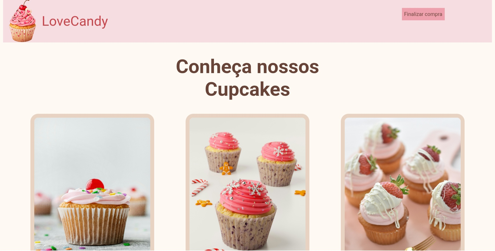
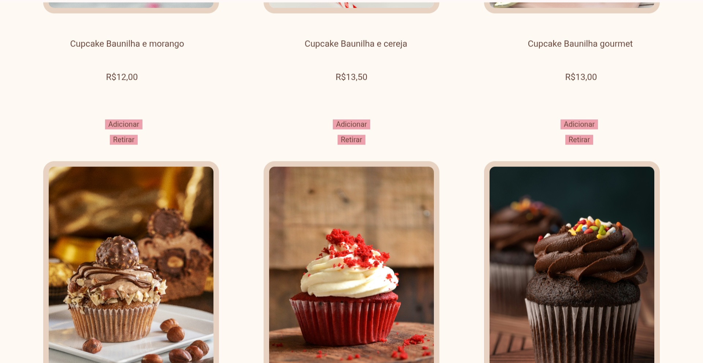
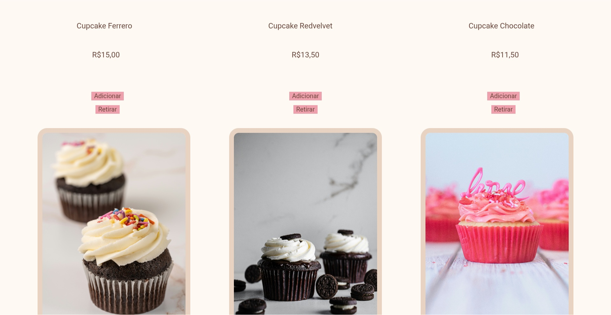
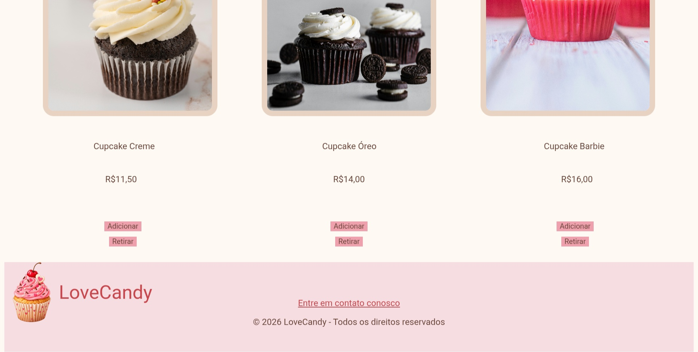

# Doceria-Projeto

Projeto *Front-End* website doceria

## Técnologias utilizadas

- HTML5
- CSS3
- JavaScript

## Como instalar e executar

1. Faça o download do repositório em formato ZIP.
2. Extraia a pasta do projeto.
3. Abra a pasta extraída. 
4. Localize o arquivo index.html.
5. Selecione "Abrir com" e escolha seu navegador.
6. O site será aberto e estará pronto para visualização. 

## Demonstração

## Autor e contato

Nome:*Bianca Tavares Carvalho*
[Meu linkedin](https://www.linkedin.com/in/biancatavarescarvalho/)
